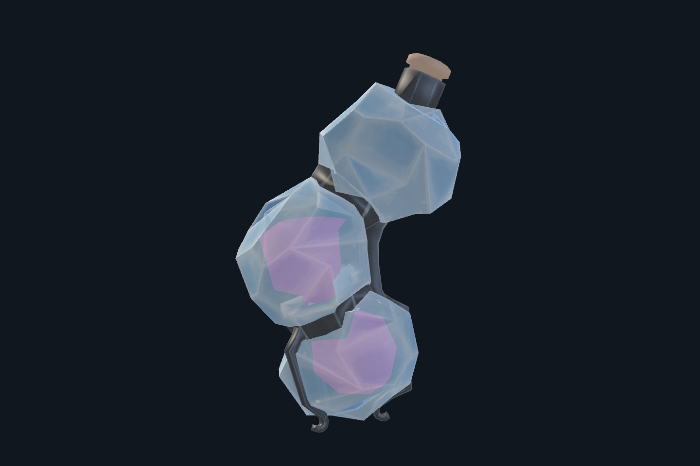

# Crystal Gourd 1.0.5

The Crystal Gourd is a craftable canteen that holds three servings of water, potions, or other compatible liquids. Its frosted crystal shows the color and fill level of the liquid inside. It stays open while empty. Hold it in one hand and pull the cork with the other when sealed. The cork returns when the filled gourd is stowed or set down.



Carry it in a side belt slot, a backpack storage slot, or a normal shelf slot. To hang it from the backpack's Potion Hoops, bring the gourd's neck to an empty hoop and release it.

## Install

Download the DLL for your setup from the [Crystal Gourd 1.0.5 release](https://github.com/calebv2/Crystal-Gourd/releases/tag/v1.0.5).

Requires MelonLoader and the same build of SyncLib with `workbench-crafting-v1` on the server and PC clients. This release was tested with SyncLib 1.1.1 carrying that feature.

- For separate installations, put `CrystalGourd.Server.dll` in the dedicated server's `Mods` folder and `CrystalGourd.Client.dll` in each player's `Mods` folder.
- For a shared `Mods` folder, use the combined `CrystalGourd.dll` on its own. It also works in separate server and client installations. Use one Crystal Gourd DLL per folder.

## Craft

Use a standard workbench with the Crystal Gourd recipe page. Place one Metal Buckle, then three Blue Crystal Gems, one at a time. Grab the finished gourd from the workbench.

## Admin spawn commands

Replace `PLAYER` with the player name.

```text
spawn PLAYER ATT_CrystalGourd
spawn PLAYER ATT_CrystalGourd_Recipe
```

## Build from source

On Windows, use Unity 2020.3.23f1 and a local A Township Tale PC installation with MelonLoader and a compatible SyncLib DLL. Run this from the repository root in PowerShell.

```powershell
.\Build-Windows.ps1 -GamePath 'D:\Games\A Township Tale'
```

The script builds the client, server, and combined DLLs into `bin/` using the included art bundle. Use `-CompilerPath` for a custom Unity Roslyn compiler location and `-SyncLibPath` if SyncLib is stored outside the game's `Mods` folder.

The `Unity/` project contains the flask models, material shaders, and the editor build code. To regenerate the art bundle, supply `ATT Blue Crystal.png`, `MetalPanels_diffuse.png`, and `woodcutting_d.png` in `Unity/Assets/CrystalGourd/Models/`. The blue crystal texture uses a 256 × 256 image with a 10-pixel edge border. Open the project in Unity 2020.3.23f1 or run its builder from PowerShell.

```powershell
& 'C:\Program Files\Unity\Hub\Editor\2020.3.23f1\Editor\Unity.exe' -batchmode -quit -projectPath (Resolve-Path ./Unity).Path -executeMethod CrystalGourdAssets.Build
.\Build-Windows.ps1 -GamePath 'D:\Games\A Township Tale' -BundlePath './Unity/Build/crystal-gourd-art'
```

A Township Tale game assets are by Alta.
